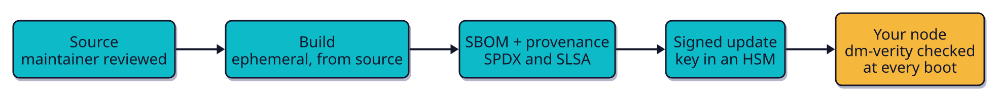

<!-- _class: cover -->
<!-- _paginate: false -->

# Flatcar Container Linux: Growing the Cloud Native OS Ecosystem

## Project Lightning Talk, KubeCon + CloudNativeCon North America 2026

  
  

    <strong style="font-size: 32px">Jan Bronicki</strong> 
    Flatcar Maintainer, Software Engineer at Microsoft 
    @John15321
    jan-bronicki
  

---

# Growing in the CNCF

- CNCF **incubating** project, with graduation on the roadmap
- Runs Kubernetes nodes on the major clouds and bare metal
- Alpha, Beta, Stable and LTS channels, each release tested across clouds before it ships
- Extensible by design: Docker, containerd, Podman and GPU drivers ship as **sysexts**

---

# Supply chain integrity

- Signed **SPDX SBOM** published with every image
- Assessed at **SLSA Level 3**, per-package provenance in `/usr/share/SLSA/`
- Coming: **VEX files** with every release, so you know which CVEs matter
- Next: TPM chain of trust, scalable release signing

---

# Roadmap, and where you can help

- **Now:** CNCF graduation, systemd-sysext and confext, TPM and Secure Boot
- **Next:** full-disk encryption, a more automated release pipeline
- **You:** good first issues, docs, testing new platforms, sysext images
- Find us: **Project Pavilion, kiosk P-8A**, Hall 5, Cosmic Canyon Zone

---

<!-- _class: closing -->
<!-- _paginate: false -->

# Secure by design. Open by default. Come build it with us.

 Join our Discord!

  <a href="https://flatcar.org"> flatcar.org</a>
  <a href="https://github.com/flatcar"> github.com/flatcar</a>
  <a href="https://discord.gg/PMYjFUsJyq"> discord.gg/PMYjFUsJyq</a>

  <strong>Office hours</strong> · every 2nd Thu, 16:30 CEST
  <strong>Dev sync</strong> · every 4th Thu, 16:30 CEST

